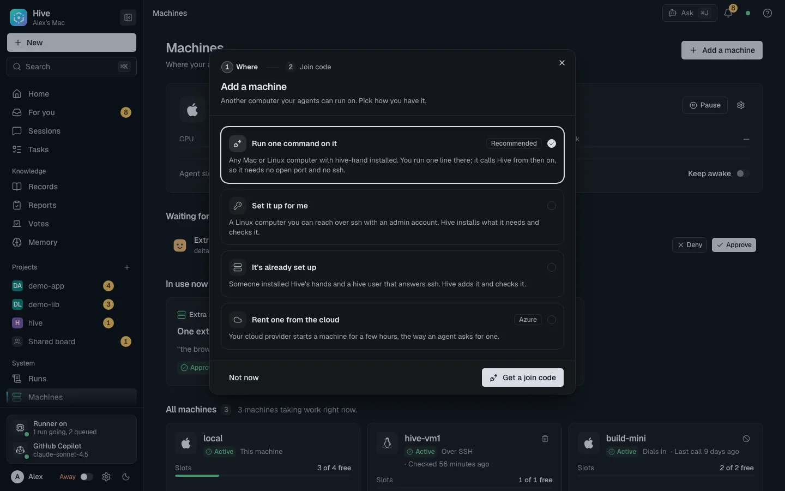

# Add a second machine

Pair a Linux machine over SSH, or join a Mac or Linux machine with a code,
so jobs can run there. Then say what a project's jobs need from a machine.

**Before you start**

- Hive runs on your machine with a registered project and the runner
  ([Set up your first project](first-project.md)). The runner is the
  console's word for the daemon (`hive daemon`).
- GitHub Copilot is your model provider and it is connected
  ([Choose models and set budgets](models.md)). Hive sends a second machine
  the model names in your settings and no provider: the machine calls GitHub
  Copilot, with a GitHub login of its own that the steps below place.
- To pair (steps 2 to 4): a Linux machine on x86_64 or arm64 with `git` and
  glibc 2.36 or newer (Debian 12, Ubuntu 24.04), where an admin account
  logs in over SSH with a key and runs `sudo` without a password.
- To join with a code (step 5): a Mac or a Linux machine with a terminal.

## 1. Know what runs where

The machine with the store stays in charge. The store is the file
`~/.hive/hive.sqlite`, which holds everything Hive knows. That machine runs
the runner, plans the work, delivers the pull requests, and runs the reviews
and the jobs of the lead (`my-app-lead`, the agent that owns the project). A
second machine runs only the jobs it is handed, each in a clone of its own.
A **job** is one run of an agent.

The second machine has no store: the board, the settings and your other
projects are not on it. Each job arrives on its own, with the code of one
branch and a brief. The machine gets no git credential and does not push:
your machine fetches the commits, checks who made them and delivers the
branch. It does hold your code while a job runs and a model login of its
own, and a job's commands run there with that machine's network.

Which job goes where is a matter of words. A machine **offers** its system
(`linux`, `macos`), its chip (`amd64`, `arm64`) and labels such as `docker`.
A job that **needs** some of these words runs only on a machine that offers
them all. A job that needs nothing fits any machine.

## 2. Check the machine first

Work from the account that runs the runner. Hive cannot answer a question
during the pairing, so make sure the admin login asks none, not even about a
new host key. Then let Hive read the machine: with `--dry-run` it changes
nothing, on either side.

```bash
ssh admin@linux-box.example.com sudo -n true    # prints nothing when the key and sudo both work
hive pair admin@linux-box.example.com --name linux-box --dry-run
```

The dry run prints what it found (`uname=Linux`, `sudo=yes` and more), the
script it would run there as root, the script that undoes it, and what it
would change on your machine. Hive refuses to pair a machine that is not
Linux, and an admin whose `sudo` asks for a password. The name is how Hive
lists the machine: lowercase words with dashes, and not `local`. Do not name
it exactly as the host after `admin@`: the SSH `Host` block of step 3 would
then cover your admin login too, and offer Hive's key, not your default keys.

## 3. Pair it

```bash
hive pair admin@linux-box.example.com --name linux-box
```

The run registers the machine in the store, and it changes two more places:

- **On `linux-box`, as root.** A `hive` user. The program, as
  `/usr/local/bin/hive-hands` with `/usr/local/bin/hive` linked to it. The
  work directory `/srv/hive`. One line in that user's `authorized_keys`,
  which lets Hive's key run its job commands and nothing else. `mise`,
  downloaded from GitHub and checked, which installs the tools a project
  pins. A file for sshd, `/etc/ssh/sshd_config.d/60-hive-hands.conf`, which
  turns off passwords, forwarding and terminals for that user.
- **On your machine.** A key, `~/.ssh/hive_hands_ed25519`, when there is
  none yet. A `Host linux-box` block at the end of `~/.ssh/config`, for the
  `hive` user and that key; the file as it was is kept as
  `~/.ssh/config.bak`. The machine's host keys in `~/.ssh/known_hosts`.

The program Hive copies there is a Linux `hive`: its own, when your machine
is Linux on the same chip. From a Mac the run stops before it changes
anything, with `no Linux hive to send to that machine`, and names the release
archive to download. Unpack it and name the file, with the tag for `TAG`:

```bash
HIVE_HANDS_BINARY="$PWD/hive-TAG-x86_64-unknown-linux-gnu/hive" \
  hive pair admin@linux-box.example.com --name linux-box
```

On a new machine the run ends with exit status 1, and its summary starts
with the line below. That is expected: the machine is paired, and it takes
no work until it has a model login. Under it, the `probe` line reads
`FAILED: harness login missing` and the `next` line names the next step.

```text
paired linux-box: drained (the probe did not pass)
```

## 4. Give it a model login

```bash
hive executor login linux-box --admin admin@linux-box.example.com   # a login for its hive user
hive executor probe linux-box                                       # checks the machine again
```

The first command places a GitHub login for Copilot on the machine: the
token you stored with `hive executor token`, or else your own GitHub Copilot
login when that login reaches no repository. With neither it stops with
`No login source for executor linux-box`. Then pipe a GitHub token into the
same command with `--with-token` added. It takes a fine-grained token with
the Copilot Requests permission and refuses a classic one.

Once the login is stored, Hive probes the machine and makes one small model
call there. When the model answers, the machine is `active` and takes work.
The probe prints `linux-box ok, active:` and what the machine reported, such
as its system, its free disk and the `docker` it found.

## 5. Or join a machine with a code

`hive pair` takes Linux only, and you may not want to hand Hive an admin
login. Then the machine joins by itself: it keeps a key of its own, calls
your Hive for work and opens no port. On the second machine, install both
programs and give it a model login:

```bash
curl -fsSL https://hivefleet.dev/install.sh | sh -s -- --hand   # hive-hand, in ~/.hive-hand/bin
curl -fsSL https://hivefleet.dev/install.sh | sh                # hive, in ~/.hive/bin
export PATH="$HOME/.hive/bin:$HOME/.hive-hand/bin:$PATH"
hive harness login                                              # this machine's model login
```

On your machine, open **Machines** in the console, choose **Add a machine**,
keep **Run one command on it** and choose **Get a join code**.



The dialog shows a six-word code, good for ten minutes and one join, and the
line to run on the machine. The console listens on `127.0.0.1` only, so that
address reaches it from your own machine alone. The dialog says so and shows
two lines instead: an SSH tunnel to your machine, then the join through it.

```bash
ssh -N -L 8765:127.0.0.1:8765 YOU@THIS-MACHINE &
hive-hand join --brain http://127.0.0.1:8765 amber-river-cobalt-maple-orbit-lantern
```

Put your login and your machine's name in place of `YOU@THIS-MACHINE`; your
machine has to accept that SSH login. The tunnel puts the whole console
within that machine's reach, not only the join, so open it between machines
of your own. `hive-hand join` prints `joined ... as ...` with the name the
machine is listed under: its host name, unless you add `--name linux-box`.
It then stays connected, and the dialog changes to **Machine joined**. Keep
the tunnel open, and on every later start run `hive-hand dial`. A code that
has lapsed or was used is refused: choose **New code**.

## 6. Say what a machine offers and what a job needs

```bash
hive executor list
```

```text
local          active      this machine                   workers 6 busy 0 projects *
               offers macos arm64 xcode
```

`local` is the machine with the store. `linux-box` has a block of its own
under it, with its own `offers` line. A machine finds its system, its chip,
`docker` and `xcode` by itself. Add other words yourself:

```bash
hive executor label linux-box +gpu      # adds a word; -gpu takes it away
hive settings set machine.labels gpu    # the whole list for the machine with the store
```

A job that needs nothing fits either machine. Set needs when a job must
have something. For one job that you queue yourself, say it on the job:

```bash
hive job add --project my-app --title 'Rebuild the images' \
  --brief 'Run docker build for each service and say what failed.' --needs linux,docker
```

For every job of a project, set the needs on the project. They bind the
lead's jobs and the reviews too, and those run only on the machine with the
store: when it lacks one of the words, they wait in the queue and nothing
plans the project's tasks. So give a project only words `local` offers. In
the list above that rules out `linux` and `docker`; `gpu` is a word both
machines now offer. In the console, open the project and its tab
**Team & tools**: the panel **Runs on** has **Change**. Or, in the checkout:

```bash
cd ~/code/my-app
hive init --needs gpu    # prints: refreshed project my-app at ~/code/my-app
```

A line `needs: [gpu]` in the project's `.hive/hive.yaml` does the same
once it is on the default branch, and replaces what you typed. **Runs on**
then lists each machine as fitting, or names the word it lacks.

## 7. Take a machine out of work

```bash
hive executor drain linux-box      # for a while: running jobs finish, no new job starts
hive executor probe linux-box      # back to work, when the probe passes
hive remove executor linux-box     # for good: shows what changes, then asks
hive executor activate linux-box   # undoes a remove, while the machine still answers
```

`hive remove executor` deletes nothing on the machine. Its preview prints
the commands that remove the `hive` user and the work directory. Run them
in a session of the admin's: the printed line goes through `ssh linux-box`,
the login that runs Hive's job commands and nothing else. In the console, a
paired machine's card has **Remove machine…** and a joined one
**Revoke its key…**: Hive forgets the key and sends that machine no more work.

## Check that it worked

- In the console, **Machines** lists `linux-box` under **All machines**. Its
  card says **Active**, and **Over SSH** (paired) or **Dials in** (joined).
- In a terminal, `hive executor list` shows `linux-box` as `active`, and
  `hive executor probe linux-box` prints `linux-box ok, active:`.
- After a job has run there, open it on **Runs**: its **Technical details**
  have a **Machine** row that names `linux-box`.

## When something goes wrong

- **`sudo without a password is required`.** The pairing uses `sudo -n`,
  which never asks. The program's own advice is a `NOPASSWD` rule: on
  `linux-box`, run
  `echo 'admin ALL=(ALL) NOPASSWD: ALL' | sudo tee /etc/sudoers.d/admin`.
  Jobs do not use that login: they run as the `hive` user.
- **The card says Not taking work.** Its **Why:** line gives the last
  probe's reason. For `harness login missing`, do step 4. For
  `under 10 GiB free on /srv/hive`, free space there. Then probe again.
- **The card says Can't reach it.** After three failed connections in a row
  Hive sends no work there. A probe that passes puts it back. Hive probes a
  paired machine by itself, at growing waits; `hive executor probe linux-box`
  checks at once. A joined machine also comes back when it connects again:
  with its tunnel open, start `hive-hand dial` there again.
- **A job waits and no machine takes it.** On the project's **Team & tools**
  tab, **Runs on** names the word of the project's needs that each machine
  lacks, and says **Nothing can take this project's jobs right now** when no
  active machine fits. The lead's jobs and the reviews need `local` to fit
  (step 6). Label a machine that has the tool, change the needs, or let one
  waiting job run anywhere with `hive job needs JOB_ID -`.
- **Set it up for me ends with The setup didn't finish.** The dialog says
  **The setup stopped** and shows the report. With the line
  `paired linux-box: drained (the probe did not pass)` in it, the machine is
  paired and waits for its model login, as in step 3: do step 4. Words picked
  under **What it offers** were not saved: add them with `hive executor label`.

## Read more

- [Machines and paired hands](../machines.md): every step of pairing and
  joining, where a job goes, and how Hive notices a machine that went quiet.
- [The machines you pair](../security.md#the-machines-you-pair): what a
  second machine is sent, what it never gets, and how to revoke it.
- [`hive-hand`](../release.md#hive-hand): installing the program a joined
  machine runs. [The Mac app](../mac-app.md#joining-a-brain) joins a Mac.
