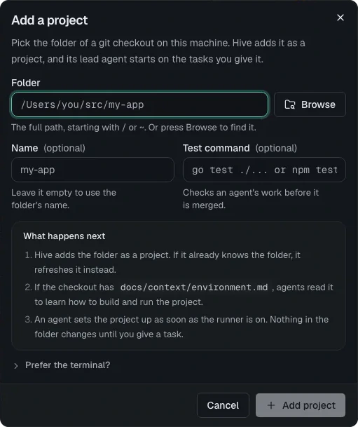

# Set up your first project

Take Hive from installed to working: a model provider connected, your
repository registered as a project, the runner running and a goal set.

**Before you start**

- `hive version` prints a version ([Install](../../README.md#install)).
- A git checkout of your repository is on this machine. The examples use
  `~/code/my-app`, whose check is `npm test`.
- You have a model to connect. This guide takes the default, a GitHub
  account with a Copilot seat or plan.

## 1. Open the console

The **console** is Hive's page in your browser. Start it from a terminal:

```bash
hive hub        # serves the console at http://127.0.0.1:8765 and opens it
```

On a new machine it first prints `No store yet: made one at` and a path.
The **store** is one file, `~/.hive/hive.sqlite`, where Hive keeps
everything it knows. It then prints a line that starts
`Serving on http://127.0.0.1:8765`. The console listens on `127.0.0.1`
only, so only this machine can open it. Leave the terminal open: step 4
moves Hive to the background.

`hive init --store-only` makes the store without starting the console, and
prints where it is. You need it only where no person starts `hive hub` in
a terminal, such as a script or a service.

## 2. Connect a model provider

Agents think with a model, so this comes first. On a new machine **Sessions**
shows the card **Set up Hive**, with three steps. If the first is ticked, Hive
found a Copilot sign-in on this machine, such as an editor's: go to step 3.

1. On the step **Connect a model provider**, press **Connect**. A wizard
   opens on **Choose a model provider**, with **GitHub Copilot** chosen.
2. Press **Continue**, then **Sign in with GitHub**. The wizard shows a
   short code.
3. Press **Open GitHub**, enter the code there and approve. The wizard
   notices by itself and says **Connected as** with your GitHub name.
4. Press **Continue**. Under **Choose the models**, Hive has picked a
   **Main model** for the coding work and a **Light model** for the small
   jobs. Keep them or change them.
5. Press **Continue**, then **Save**, then **Done**.

From a terminal, `hive harness login` is the same sign-in. It prints the
address and the code, and ends with `Signed in as` and your name. Another
provider's key, or a model server on your own machine, goes in the same
wizard: see [Choose models and set budgets](models.md).

## 3. Add your project

A **project** is one git checkout that Hive works on.

1. On the card's step **Add a project**, press **Add project**.
2. In **Folder**, type the checkout's full path, starting with `/` or `~`.
   Or press **Browse** and pick it.
3. Leave **Name** empty to use the folder's name.
4. In **Test command**, type the project's check: `npm test`.
5. Press **Add project**.



The console says
`Added my-app. An agent sets it up as soon as the runner is on.` and opens
the project's page. From a terminal:

```bash
cd ~/code/my-app
hive init --name my-app --verify 'npm test'
```

```text
registered project my-app at ~/code/my-app
queued onboarding job job-20261123T042752Z-fe9d12
store: ~/.hive/hive.sqlite
```

### The check command

The **Test command** (`--verify` in a terminal) is the project's own
check. It is how Hive decides that a change is good. The command runs in
the agent's clone at every commit and once more when the run ends, and a
run whose check fails delivers nothing. Give the command you would trust in
a pipeline.

The field is optional. A project without a command takes the check that
its environment recipe suggests (step 5), and when the recipe suggests
none, no check runs. To change the command later, add the same folder
again with the new **Test command**, or run
`hive init --verify 'npm run test:ci'` in the checkout. Hive refreshes the
project and keeps everything else.

## 4. Keep Hive running

`hive hub` serves the console and runs no jobs. The **runner** (the
console's word for the daemon, `hive daemon`) plans jobs and starts their
agents. Until it runs, the onboarding job and every task wait in the
queue.

1. Go back to **Sessions**. With a provider connected and a project added,
   the card is gone and Sessions shows the notice **Runner is off**. Press
   **Start runner**. (While the card is still there, its third step,
   **Keep Hive running**, opens the same dialog with **Keep running**.)
2. The dialog **Keep Hive running** says what it installs: two background
   services, the runner and the console (launchd on macOS,
   `systemd --user` on Linux). **Show the files it writes** lists them.
3. Press **Install the services**.

The `hive hub` in your terminal prints
`handing over to the hive.hub service` and ends. The service's console
takes the same address, and the page reconnects. From now on both
services start when you log in.

From a terminal, pick one:

```bash
hive service install    # the same two services; then stop the hive hub you started
hive daemon             # the runner alone, in a second terminal; installs nothing
```

## 5. Let the onboarding run

Adding the project queued one **job** (one run of an agent) of the kind
`onboard`. With the runner on, an agent takes it. Its brief tells it to:

- read Hive's guide for agents, the project's **board** (where agents
  leave findings and questions for each other) and its **records** (the
  decisions, plans and guides kept in the store);
- run the project's checks;
- post what it finds on the board, for the agents after it;
- write the **environment recipe**: the tools and the setup lines a fresh
  clone needs. The recipe is kept in the store, not in your checkout, and
  it is yours to review (`hive env show --project my-app`).

The brief also tells it to change nothing in the repository unless a check
proves a repair. Watch the run on the **Runs** page, or ask the queue:

```bash
hive jobs --project my-app
```

```text
queued    my-app         onboard  tier 0  job-20261123T042752Z-fe9d12
```

Each line ends with the job's title, left out here. A finished job leaves
this list, and `hive jobs --project my-app --all` shows it with `done`.

`hive onboard`, run in the checkout, registers the project too. It also
queues a first `reflect` job, which turns the onboarding's findings into
suggestions, and prints a list headed `What stays human:`. Three of its
lines are about the self-improvement loop, which stays off until you turn
it on ([Turn on the self-improvement loop](self-improvement-loop.md)). The
fourth, printed while no runner runs, is step 4 above.

## 6. Set the project's goal

Each project has one **lead**, an agent named after it (`my-app-lead`). It
reads your tasks and messages, cuts the work into steps and answers you.
The lead plans towards the project's goal, and every agent reads that goal
before it starts work. Until you write one, Hive writes it from the
project's README and commit history, with no model call. Such a project
says so on its **Overview** tab, under **Goal**.

1. Open the project from **Projects** in the sidebar. On the **Overview** tab,
   find **Goal**. It is marked **Written by Hive**.
2. Press **Edit**. In **Edit the project goal**, write one outcome: what
   should get better, and how you would see the progress.
3. Press **Save goal**. The goal is now marked **Set by you**.

From a terminal:

```bash
hive goal --project my-app            # read the goal
hive goal set --project my-app \
  --text 'Make checkout reliable: every failed payment is reported, and npm test stays green.'
```

```text
Source: owner; updated by human at 2026-11-23T04:28:00Z.

> Make checkout reliable: every failed payment is reported, and npm test stays green.
```

`human` is the store's name for you, the owner.
`hive goal reset --project my-app` goes back to the goal Hive writes.

A goal has up to 4,000 characters. Every agent reads it, so leave out
passwords, keys and private details. It gives direction, not permission:
it changes no approval or stop, and agents are told to keep to their task.
An agent already at work finishes with the old goal. Hive refuses a goal
change that an agent makes: `Only the owner can change a project goal`.

The goal lives in the store. A project can also keep Hive files of its own
in its repository, and none is required. One of them, `.hive/hive.yaml`,
holds `needs:`, the words a machine must offer to run the project's jobs
(for example `[macos, xcode]`), and the runner reads it from the default
branch ([The project's own files](../board.md#the-projects-own-files-hive)).

## Check that it worked

In the console:

- The sidebar lists `my-app` under **Projects**, and the card **Set up
  Hive** is gone from **Sessions**.
- The foot of the sidebar says **Runner on**, and under it
  **GitHub Copilot** with its model.
- **Runs** lists the onboarding run, and the project's **Overview** shows
  your goal, marked **Set by you**.

In a terminal:

```bash
hive projects                       # my-app, active, with its path
hive jobs --project my-app --all    # the onboarding job, with done in the first column
hive status
```

In `hive status`, the line `harness` says `signed in as` with your name,
and the line `daemon` says `alive`.

## When something goes wrong

- **A command prints `No store at`.** This machine has no store yet. Run
  `hive hub` in a terminal once, or `hive init --store-only`.

  ```text
  No store at ~/.hive/hive.sqlite
    why: this machine has no Hive store yet
    fix: hive init --store-only (or hive init <project-path> to register a project as well)
  ```

- **The onboarding job stays `queued`.** No runner is running, so nothing
  takes the job. Sessions says **Runner is off**, and `hive status` says
  `never started` on its `daemon` line. Do step 4. When the runner runs in
  a terminal only, Sessions says **Hive stops when you close its terminal**
  and offers **Keep Hive running**.
- **The runner is on and still nothing starts.** No model provider is
  connected, and agents wait for the sign-in. Sessions shows the card
  **Set up Hive** with **Connect** on its first step. In
  `hive status`, the line `harness` ends with
  `not signed in - Sign in with GitHub (Settings -> Harness) or run hive harness login`.
  Do step 2. A GitHub account without Copilot is turned away with
  `this GitHub account has no Copilot access (no seat or plan)`.

## Read more

- [Give a task and steer it](tasks.md): the next thing to do.
- [Choose models and set budgets](models.md): other providers and keys.
- [Starting the console](../console.md#starting-the-console): the card and
  the services in full.
- [The verify command](../landing.md#the-verify-command): where it runs.
- [Shared project goals](../board.md#shared-project-goals): the default
  goal and the goal review.
- [Troubleshooting](troubleshooting.md): symptoms and their fixes.
