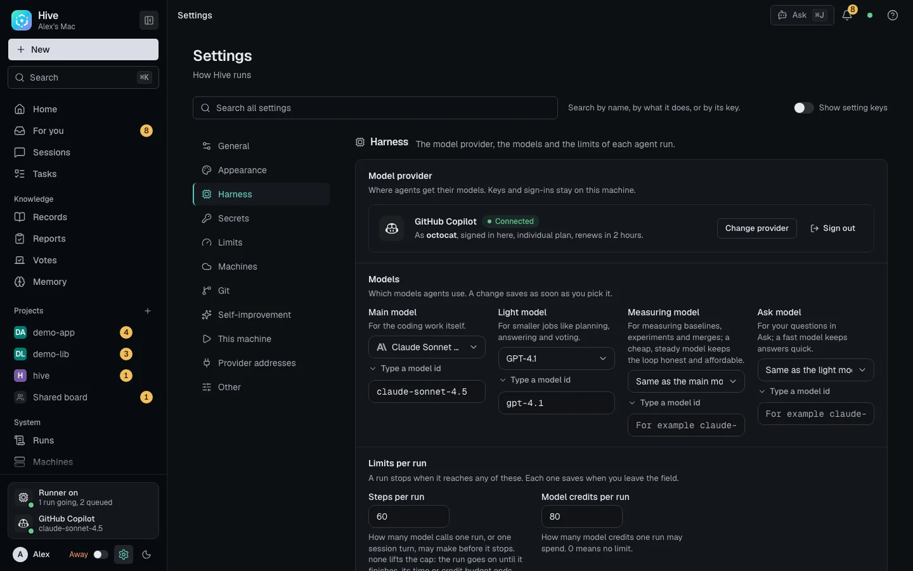

# Choose models and set budgets

Connect a model provider, give each kind of run its own model, and set how
much one run and one day may use.

**Before you start**

- Hive is installed and the console opens at `http://127.0.0.1:8765`
  ([Install](../../README.md#install)).
- You have one of these: a GitHub account with GitHub Copilot, an API key of
  another provider, or a model server such as Ollama on this machine.

## 1. Connect a provider

Hive's agents call a model through one **provider** at a time. GitHub
Copilot is the default. In the console, open **Settings** and then
**Harness**. The block **Model provider** names the provider and says
**Connected** or **Not connected**. When it says **Connected** before you
have signed in, Hive found a GitHub login for Copilot on this machine (in
the environment, from an editor or from the Copilot CLI) and borrows it: go
on to step 3. Otherwise choose **Connect GitHub Copilot**. A dialog opens at
its **Connect** step:

1. Choose **Sign in with GitHub**. A short code appears.
2. Choose **Copy code**, then **Open GitHub**. Enter the code there and
   approve. The dialog notices by itself and says **Connected as** with your
   GitHub name.
3. Choose **Continue**. The **Models** step proposes a **Main model** and a
   **Light model** from the provider's list. Step 3 says what each is for.
4. Choose **Continue**, then **Save**. The dialog ends with **Agents now use
   GitHub Copilot**.

That is GitHub's sign-in, not Hive's: Hive has no accounts. The same from a
terminal:

```bash
hive harness login    # prints an address and a code to enter there
```

It ends with `Signed in as`, your GitHub name and `(GitHub Copilot)`.

## 2. Use a key or a local server instead

In **Model provider**, choose **Change provider**, or **Choose another
provider** while none is connected. The dialog starts one step earlier, at
**Provider**, and lists every provider this Hive can use:

| Group in the dialog | Providers | The **Connect** step asks for |
| --- | --- | --- |
| **Sign in with an account** | GitHub Copilot, Anthropic Claude, GitHub Models, Azure OpenAI | a sign-in in your browser, or a key or token; Azure OpenAI also asks for your resource's address |
| **Use an API key** | OpenAI, Google Gemini, OpenRouter, Groq, Mistral, DeepSeek, xAI Grok, Together AI, Fireworks AI, Cerebras | the key |
| **Run models on this computer** | Ollama, LM Studio, vLLM | the server's address, and a key only when your server asks for one |
| **Something else** | Another OpenAI-compatible server | its address, and a key unless the server needs none |

- **A key.** Pick the provider and choose **Continue**. Paste the key into
  the field, which for OpenAI is labelled **OpenAI API key**, and choose
  **Connect**. Hive checks the key with the provider before it keeps it.
- **A local server.** Pick **Ollama** and choose **Continue**.
  **Server address** already holds `http://127.0.0.1:11434/v1`. Choose
  **Check the connection**. The dialog answers **Reached it** and the number
  of models the server has.

Then go on through **Models** and **Review** as in step 1. The last button
reads **Switch to** and the provider's name. The provider in use changes
when you press it, and runs that have started finish on the old one.

From a terminal, connect first and switch last:

```bash
printf '%s' YOUR_KEY | hive harness login --provider openai --with-token
hive harness models --provider openai    # the model ids this key can use
hive settings set provider openai        # new runs use it from now on
```

The first line hands the key over on standard input; typed like this it
also lands in your shell's history, which the console's field avoids. A
local server needs only the switch, `hive settings set provider ollama`;
another address than the default goes into the setting
`provider.ollama.base_url`. A switch made this way leaves the model
settings as they were, with the old provider's ids, so set them next
(step 3).

### Where a key is kept

A pasted key or token, and a sign-in with GitHub or Microsoft, is a file on
this machine: `~/.hive/private/providers/<provider>.json`, which only your
user can read. It is not in the store (`~/.hive/hive.sqlite`), where the
settings are. A sign-in with Anthropic stays with Anthropic's own program,
`ant`, which must be installed on this machine. Hive uses a key for calls
to the provider, and the console shows its last four characters and never
the whole key. The one login Hive can copy elsewhere is a GitHub login for
Copilot, to another machine of yours
([Add a second machine](add-a-machine.md)).
`hive harness logout --provider openai` removes the file.

A job runs as your user. What keeps its commands away from that folder is a
check on the text of each command: a rule, not a barrier
([Security notes](../security.md#agents)).

## 3. Choose a model for each kind of run

A **job** is one run of an agent. Hive puts its runs into four groups, each
with a model setting of its own. In **Settings**, under **Harness**, the
block **Models** has a list for each. A choice is saved as soon as you make
it.



| In the console | Setting | The runs it serves | While it is empty |
| --- | --- | --- | --- |
| **Main model** | `worker_model` | the runs that change code: task, improve and experiment jobs | the provider's default model |
| **Light model** | `light_model` | the light runs: the lead's planning, answers, votes, reflections, reviews and the like | the main model |
| **Measuring model** | `measure_model` | the measurements of the self-improvement loop | the main model |
| **Ask model** | `ask.model` | your own questions in the console's Ask | the light model |

The lead is the agent that owns a project and plans its tasks
(`my-app-lead`). From a terminal:

```bash
hive harness models                               # the provider's model ids; * marks its default
hive settings set worker_model claude-fable-5.1   # an id from that list
hive settings set light_model claude-sonnet-5
hive settings get worker_model                    # prints: claude-fable-5.1
```

Hive saves a name as you typed it and does not compare it with the
provider's list, so copy the id.

Beside the models are **Main effort**, **Light effort** and **Measuring
effort** (`worker_reasoning`, `light_reasoning`, `measure_reasoning`): how
hard the model is asked to think, from `minimal` to `max`. While empty, the
main and the light effort follow the setting `harness.reasoning`, and the
measuring effort follows the main one. The default of `harness.reasoning`
sends nothing and leaves the choice to the model.

```bash
hive settings set worker_reasoning high
```

GitHub Copilot falls back to the nearest effort a model offers. With the
OpenAI-compatible providers, a model that does not take the field rejects
the call. The Anthropic and Gemini providers ignore these settings.

## 4. Set the budgets

| Setting | Console | Default | What it bounds | When it is reached |
| --- | --- | --- | --- | --- |
| `harness.max_steps` | **Steps per run** | `60` | model calls in one run | the run stops; **Runs** shows it as **Hit the step limit** |
| `harness.task_max_steps` | terminal only | empty | the same, for task, improve and experiment runs alone | as above |
| `minutes_per_job` | **Minutes per run** | `10` | wall-clock minutes of one run | the harness stops the run a minute before the cap, and **Runs** shows **Hit the time limit**; at the cap the runner stops the worker |
| `harness.max_cost` | **Model credits per run** | `0`, no cap | the cost Hive records for the run, in the provider's own unit | the run stops with `stopped at the cost budget` |
| `jobs_per_day` | **Runs per day (all machines together)** | `2` | jobs started in one UTC day, on all machines together | the agents' own jobs wait until midnight UTC; your tasks, the lead's sittings and answers, reviews and security updates still start |
| `capacity` | **Runs at once on this machine (auto = from its cores and memory)** | `auto` | runs at one time on this machine; `0` keeps it idle | further jobs wait in the queue; while the agents' own jobs fill every slot, one run of your own work may still start |

**Steps per run**, **Minutes per run** and **Model credits per run** are
under **Settings**, **Harness**, **Limits per run**; a field saves when you
leave it. The last two rows of the table are under **Settings**, **Limits**,
**How much work runs**. From a terminal:

```bash
hive settings set harness.max_steps 80
hive settings set harness.task_max_steps 150    # more calls for the runs that change code
hive settings set minutes_per_job 30
hive settings set jobs_per_day 20               # 0 means no daily cap
```

A value a setting does not take is refused with the reason, for example
`hive: harness.max_steps must be at least 1, not 0`. More caps exist, among
them `harness.step_timeout` (the seconds one command of a run may take) and
`lead.research_per_day` (the research jobs one project may get in a day);
[Settings](../settings.md) lists them all. Three things to know:

- Do not count on `harness.max_cost`. Hive records a cost only from a
  GitHub Copilot reply that carries one and is not streamed, and almost
  every reply of a run is streamed. With any other provider it records no
  cost at all. The step and time budgets are the ones that hold.
- A run on this machine that stops at the step budget with work in its
  clone is carried on once: the job's next run gets a fresh budget in the
  same clone.
- Hive holds every run to these numbers, but who may change them is a rule
  and not a lock. `hive help settings` says only the owner (you) changes
  caps, and the program does not refuse `hive settings set` from an agent's
  shell. `hive settings` shows who changed each setting last.

## 5. See what was used

Open **Runs** in the console. A line near the top sums up the day: the
runs, how many finished or stopped early, and the model credits recorded,
if any. Open a run for its **Duration**, **Credits** and **Tokens**.
**Credits** shows the cost Hive recorded for the run, and a dash when it
recorded none (step 4 says when it does). From a terminal, `hive status`
sets the day's count against the cap. Once a run has finished that day, it
adds lines headed `cost today`: for each kind of job, its runs, their
tokens and the cost, where one was recorded.

```text
runs today 0 of 20 (jobs_per_day)
```

`hive usage` is something else. Its help calls it
`best-effort local runner token diagnostics; never a ledger`. It reads the
token counts that four other agent programs (`copilot`, `claude`, `codex`,
`opencode`) keep in their own session files on this machine, and not Hive's
runs. It closes with `Best-effort diagnostics, not billing.` What you are
billed is in your provider's own account.

## Check that it worked

- In the console, **Settings**, **Harness** shows the provider with
  **Connected**, and your choices under **Models**. The foot of the sidebar
  shows the provider and under it the main model, or **Default model**
  while none is set.
- In a terminal:

  ```bash
  hive harness status    # the provider, who is signed in, the models and the limits in force
  hive status            # its harness line names the provider and the login
  ```

  Before a sign-in the `harness` line of `hive status` says `not signed in`.
  After it, the line ends with `signed in as` and your GitHub name, the
  last four characters of your key, or the local server's address.
- After the next job, open it on **Runs**. **Technical details** has a
  **Model** row with the provider and the model the run used.

## When something goes wrong

- **The sign-in ends with an error about Copilot access.** The message is
  `this GitHub account has no Copilot access (no seat or plan)`: the GitHub
  account you approved has no GitHub Copilot. Use an account that has it,
  or connect another provider (step 2).
- **The dialog says Hive couldn't reach the server.** The local server is
  not running or listens elsewhere. For Ollama the dialog says to start it
  with `ollama serve` and pull a model. Then choose **Check the connection**
  again, or correct **Server address**.
- **Runs end as Model provider error after you changed a model or the
  provider.** A model setting may hold an id the provider does not have:
  Hive does not check a typed id, and a switch from a terminal keeps the
  old ids. Pick the models again under **Settings**, **Harness**,
  **Models**, where the lists come from the connected provider.
- **A run ends as Hit the step limit or Hit the time limit.** Open the run.
  Under **Result** it says **Stopped early: it used every step it was
  allowed.** or **Stopped early: it ran out of time.** Raise the budget in
  step 4. For the runs that change code, `harness.task_max_steps` raises
  the step budget without giving every small job the same.
- **Jobs wait though nothing runs.** The daily cap may be full. In
  **Settings**, **Limits**, the row **Runs per day (all machines together)**
  then warns that today's runs already reach the cap. Raise the number, or
  set `0` for no cap.

## Read more

- [Providers, sign-in and models](../harness.md#providers-sign-in-and-models):
  every provider, its environment variables and its address setting.
- [Budgets, context and compaction](../harness.md#budgets-context-and-compaction):
  what a long run does about a full context window.
- [Settings](../settings.md): every setting with its default.
- [Secrets](../security.md#secrets): where each kind of secret rests.
- [Set the rules agents work under](rules.md): the kill switch, which stops
  all work at once.
