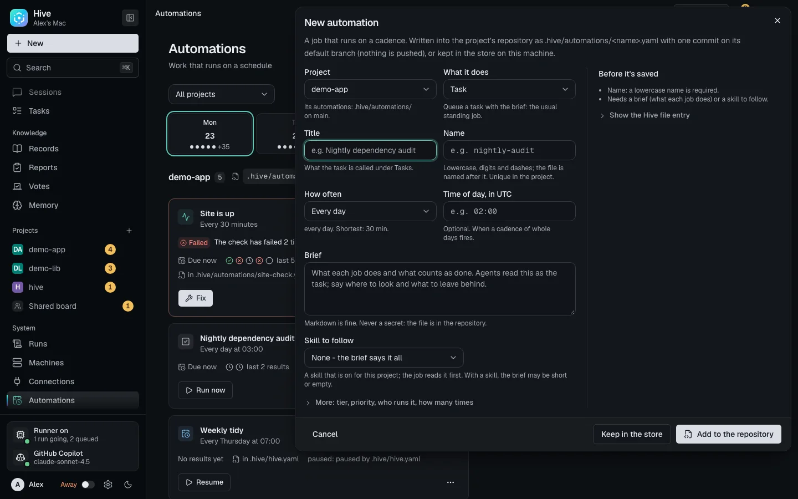

# Run work on a schedule

Set up a weekly job for an agent and a script that checks your site every
half hour. See both in one place, and pause or end them.

**Before you start**

- Hive is installed and the console opens ([Install](../../README.md#install)).
- The project `my-app` is registered and the runner is running
  ([Set up your first project](first-project.md)). The runner is the
  console's word for the daemon (`hive daemon`). It does the scheduling.

## 1. Choose the kind of schedule

A schedule belongs to one project and comes round on a cadence. A **job** is
one run of an agent. There are three kinds of schedule:

| Kind | What runs each time | Model calls | Use it for |
| --- | --- | --- | --- |
| A standing job: `task`, `improve`, `clean` or `reflect` | An agent, in one job, from the brief you wrote | On every run | Work that needs judgement, such as a weekly dependency review |
| `check` | A script from your repository, run by the runner | Only when the script fails | What must stay true: the site answers, the tests pass |
| `watch` | A script from your repository, run by the runner | Only when the script prints something or keeps failing | What arrives from outside: a new issue, a new release |

`task` is the usual standing job. The other three queue an improvement, a
clean-up pass or a reflection instead.

## 2. Add a standing job

In the console, open **Automations** (under **More** in the sidebar) and
choose **New automation**. Fill in the form:

- **Project**: `my-app`. **What it does**: **Task**.
- **Title**: `Weekly dependency review`. The **Name** fills in from the title.
- **How often**: **Every week**. **Time of day, in UTC**: `09:00`.
- **Brief**: what the agent does each time, and how it can tell it is done.



When the panel **Before it's saved** says **Passes every check.**, choose
**Keep in the store**: the schedule lives in the store, Hive's own database
on this machine (`~/.hive/hive.sqlite`). **Add to the repository** keeps it
as a file in your project instead (step 6). Or, from a terminal:

```bash
hive schedule add --project my-app --title "Weekly dependency review" \
  --every 1w --at 09:00 \
  --brief "Update the patch and minor versions, run npm test, and list the major ones for me."
```

```text
SCHED-001 set in my-app: Weekly dependency review every 1w, first at 2026-11-23T09:00:00Z
```

`--every` takes a number and a unit (`30m`, `6h`, `1d`, `2w`) or one of
`hourly`, `daily` and `weekly`. `--at HH:MM` is a time of day in UTC and
needs a cadence of whole days. With `--at`, the first run comes at the next
09:00 UTC. Without it, the first run comes one cadence from now.

## 3. Add a check script

A check is a script in your repository that exits 0 while all is well. In
your checkout, save this one as `.hive/automations/site-up.sh`, with your
site's address in it:

```sh
#!/bin/sh
# A check: exit 0 when the site answers, anything else when it does not.
exec curl --fail --silent --show-error --max-time 20 --output /dev/null \
  https://my-app.example.com/
```

Hive refuses a script that lies outside the project's `.hive/` folder, and
one that is not committed on the default branch (`main` here). So commit it
there, then add the schedule:

```bash
cd ~/code/my-app
chmod +x .hive/automations/site-up.sh
git add .hive/automations/site-up.sh
git commit -m "Add the site-up check"
hive schedule add --project my-app --kind check --title "Site is up" \
  --script .hive/automations/site-up.sh --every 30m
```

Hive answers with the id of the new schedule, `SCHED-002`, and the time of
its first run. `30m` is the shortest cadence it accepts until you lower the
setting `schedule.min_minutes` (30 by default, never under 5), for example
with `hive settings set schedule.min_minutes 10`.

In the console, the same form adds a check: under **What it does** pick
**Check (script)**, name the script in **Script**, and choose under **Then
queue** the kind of job a failed run queues. A watch is added the same way,
with `--kind watch` or **Watch (script)**.

## 4. See what a run does

On each of its passes the runner looks for schedules that are due. For a
standing job it queues one job with your brief, and an agent takes it like
any other job. For a check or a watch it runs the script itself, in a fresh
worktree of the latest commit on the default branch, and acts on the result:

| The script | What the runner does |
| --- | --- |
| A check exits 0 | Nothing. If the check was red before, it posts on the board that it is green again. |
| A check exits with anything else, or runs past `schedule.script_timeout_minutes` (20 minutes) | The check is red. The runner queues one job to make it pass, with the exit code and the end of the output in its brief. The first red run also posts a finding on the board. |
| A watch exits 0 and prints nothing | Nothing. If the watcher was broken before, it posts on the board that it works again. |
| A watch exits 0 and prints something | Queues one job with what it printed in the brief. |
| A watch exits with anything else | The watcher itself is broken. The first failure posts a finding on the board. After three failures in a row the runner queues one job to fix the script. |

The **board** is where a project's agents post what they find. One job per
schedule is open at a time: while the job from an earlier run is still
open, a new run queues nothing. A check that stays red while that job is
open makes one job, not one for every run.

**Automations** shows the next seven days at the top and a card for each
schedule: its cadence in your own time zone, the next run, the last results
and where it is kept (**set by you**, or the file's path). **History**, in
the card's **More** menu, lists each run with its exit code, the last output
and the jobs it queued. In a terminal:

```bash
hive schedule list --project my-app   # status, state, cadence, next time (UTC), runs
hive schedule show SCHED-002          # one schedule, its brief and the jobs it queued
hive schedule log SCHED-002           # the last output of a check or watch script
```

## 5. Pause, run now or end

On a card, **Run now** makes the schedule due at once. The **More** menu
has **Pause** and **End it**, and a paused card shows **Resume**. In a
terminal:

```bash
hive schedule pause SCHED-001 --note "release week"   # stays in the list, does not fire
hive schedule resume SCHED-001                        # a time missed while paused fires once
hive schedule run SCHED-002                           # due now, on the runner's next pass
```

```text
SCHED-001 paused
SCHED-001 active, next at 2026-11-23T09:00:00Z
SCHED-002 due now; the daemon runs `.hive/automations/site-up.sh` on the next tick
```

The program's messages say *daemon* for the runner. `hive schedule end`
stops a schedule for good: it stays in the list as `ended`. Step 6 uses it.

## 6. Keep a schedule in the repository

A schedule in the store exists on this machine only. A file under
`.hive/automations/` is reviewed and versioned with the code.

In the console, open the **More** menu of a schedule you set by hand and
choose **Move into the repository**. **Show the Hive file entry** previews
the file. The button **Move into the repository** commits it on the default
branch and ends the schedule you set by hand. Nothing is pushed: the commit
goes out with your next push.

Or write the file yourself. Its name is the schedule's name:

```yaml
# .hive/automations/weekly-dependency-review.yaml
title: Weekly dependency review
every: 1w
at: "09:00"
brief: |
  Update the patch and minor versions, run npm test, and list the
  major ones for me.
```

The fields follow the flags of `hive schedule add` (`hive help manifest`
lists them). A check adds `kind: check` and `script:` with the script's
path. Check the file, commit it, apply it, and end the schedule it replaces:

```bash
hive manifest check --project my-app     # in ~/code/my-app, before the commit
git add .hive/automations/weekly-dependency-review.yaml
git commit -m "Keep the dependency review in the repository"
hive manifest sync --project my-app      # now, instead of at the runner's next pass
hive schedule end SCHED-001 --note "moved to the repository"
```

```text
.hive/automations/weekly-dependency-review.yaml: sound; 1 schedule
manifest my-app: 1 file in .hive/automations/ at 281889e3a098; schedules: 1 added
SCHED-001 ended
```

The runner reads the committed default branch of your checkout, never the
working copy or another branch, and applies the files again when a commit
changes them. From then on the file is the schedule: edit it and commit to
change it, add `paused: true` to pause it, delete it to end it. A
`hive schedule end` lasts only until the files are next applied. The older
`.hive/hive.yaml`, with a `schedules:` list, is still read.

## 7. Check the caps

One setting counts every job, and four bound schedules:

- `jobs_per_day` (2 by default): the jobs Hive may start in one UTC day, on
  all machines together. Once the number is reached, a job from a schedule
  waits until midnight UTC. Jobs for your own tasks count too, but they
  still start. A script run is not a job and does not count.
- `schedule.min_minutes` (30): the shortest cadence.
- `schedule.max_per_project` (10): the active and paused schedules per project.
- `schedule.script_timeout_minutes` (20): how long a script may run.
- `schedule.scripts_per_tick` (2): the scripts the runner runs at once, off
  its loop. While the machine is saturated it starts none.

```bash
hive status                          # "runs today 0 of 2 (jobs_per_day)" is today's count
hive settings set jobs_per_day 10    # 0 lifts the cap
```

In the console: **Settings**, **Limits**, **Runs per day (all machines together)**.

## Check that it worked

In the console, **Automations** shows a card for each schedule under
**my-app**, with the badge **Active** and when it runs next. In a terminal,
`hive schedule list --project my-app` shows them as `active` with a time
under `NEXT`, and `hive manifest show --project my-app` lists the ones the
repository keeps. After the check's first run, its `STATE` is `green` and
`hive schedule log SCHED-002` prints its exit code and output.

## When something goes wrong

- **A schedule never fires.** The runner queues the jobs and runs the
  scripts, so nothing happens while it is off or paused. Sessions then says
  **Runner is off** or **Runner is paused: nothing new starts**, with the
  button that fixes it. In a terminal, `hive status` has a `daemon` line
  that starts with `alive` while the runner runs. The runner also tends
  active projects only (`hive projects`), and `NEXT` and `--at` are in UTC.
- **A job is queued but does not start.** `jobs_per_day` may be reached: see
  the `runs today` line of `hive status`. Raise it, or wait for midnight UTC.
- **`10m is shorter than the 30m floor`.** The cadence is under
  `schedule.min_minutes`. Lower the setting (step 3) or lengthen the cadence.
- **Hive refuses the script.** `No file ".hive/automations/site-up.sh" on
  main of my-app` means the script is not committed on the default branch.
  `The script "check.sh" is outside .hive/` means it has to move under
  `.hive/`. Fix it, commit, and add the schedule again.
- **The script is not executable.** The runner then runs it with `sh`,
  whatever its first line says. A script for another interpreter needs
  `chmod +x` and a commit.
- **`hive manifest check` exits 1.** It lists each problem, for example
  ``unknown field `cadence`, expected one of name, title, every, at, kind,
  brief, skill, script, job_kind, tier, priority, run_as, times, paused``. A
  file with a problem is held: its schedule stays as it was, and the other
  files still apply. `hive manifest show --project my-app` lists the
  problems. A runner that applies the commit itself also posts them as a
  finding on the project's **For you** tab.

## Read more

- [Standing jobs](../board.md#standing-jobs-hive-schedule): the reference for `hive schedule`. Every flag: [hive schedule](../commands.md#schedule). Its settings: [schedule](../settings.md#schedule).
- [Watchers and monitors](../board.md#watchers-and-monitors): how a script runs, with two worked scripts.
- [The project's own files](../board.md#the-projects-own-files-hive): every field of an automation file.
- [Automations](../console.md#automations): the page in full.
- [Review and merge the work](pull-requests.md): where the commits of a scheduled job arrive.
- [Seat role leads on a project](role-leads.md): an agent that looks after one concern on a cadence.
- [Troubleshooting](troubleshooting.md): when the runner is off or a job fails.
