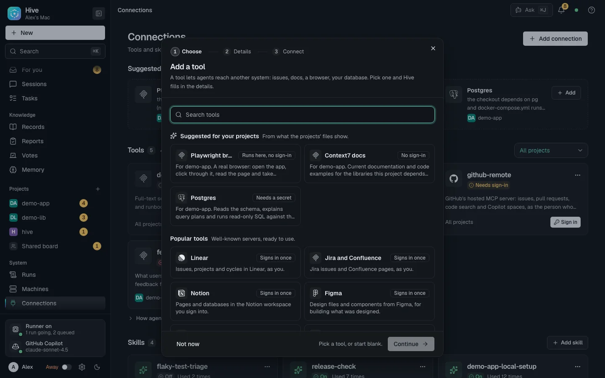

# Give agents skills and tools

Add a skill that tells agents how your team does a job, and an MCP server
that gives them new tools. See which projects get each and switch one off.

A **skill** is written instructions: a name, one line that says when to
use it, and a body in Markdown. An agent sees the name and the line, and
loads the body when the work calls for it. An **MCP server** (Model
Context Protocol) is a program or a web address that gives agents tools to
call, such as a browser or your issue tracker. The console lists MCP
servers as **Tools**.

**Before you start**

- Hive is installed and the console opens ([Install](../../README.md#install)).
- A project is registered ([Set up your first project](first-project.md)).

## 1. Write a skill and add it

In the console, open **Connections** and press **Add skill**. In the
dialog **Add a skill**, pick **Release checklist** (or **Blank**) and press
**Continue**. Fill in **Name**, **Who can use it**, **When to use it** (the
one line agents see) and **Instructions (Markdown)**. Press **Continue** to
read the skill as agents will, then **Add the skill**.

Or from a terminal: write the instructions in a file, `release-check.md`:

```markdown
Before you tag a release of my-app:

1. Run `npm test` on the default branch. Every test passes.
2. Check that `CHANGELOG.md` has a section for the new version.
3. Check that the version in `package.json` matches the tag.
```

```bash
hive skill add --name release-check \
  --description 'Checks before a release is tagged' \
  --file release-check.md
```

```text
SKILL-001 added: release-check - Checks before a release is tagged
```

The name takes lowercase letters, digits and dashes. The description is
one line of at most 200 characters. `hive skill show release-check` prints
the body as an agent reads it, and each such read counts as one use.

## 2. Keep a skill in the repository

A skill can also travel with the code, where a pull request reviews it.
Save a folder with a `SKILL.md` under `.hive/skills/`, here
`.hive/skills/ui-review/SKILL.md`:

```markdown
---
name: ui-review
description: How to check a change to a screen
---

After any change under `src/pages/`, start the app with `npm run dev`,
open the page you changed, and say in your report what you saw.
```

Commit it and merge it into the default branch. The runner (the console's
word for the daemon, `hive daemon`) reads these folders from the default
branch of the project's checkout, not from your working copy, and
registers the skill for that project after a commit that changes them. It
reads `.claude/skills`, `.github/skills` and `.agents/skills` the same way.
`hive manifest sync --project my-app` applies the default branch now, and
its answer ends with the count, here `skills: 1 added`.

Such a skill is edited in its file. `hive skill update` refuses it, and the
console shows **Kept by the repository** when you open it.

## 3. Add an MCP server

In the console, open **Connections** and press **Add connection**. The
dialog **Add a tool** lists well-known servers under **Popular tools**:
GitHub, Playwright browser, Context7 docs, Linear, Jira and Confluence,
Notion, Figma, Sentry, GitLab, Chrome DevTools, Postgres, Supabase, Stripe,
Vercel, Cloudflare, AWS knowledge, Kubernetes and Hugging Face. Those Hive
suggests for your projects come first, under **Suggested for your
projects**, and one you already added is left out. A badge on each says
how it signs in: **Signs in once**, **No sign-in**,
**Runs here, no sign-in** or **Needs a secret**. Pick **Playwright
browser**, press **Continue**, check **Name** and **Who can use it**, and
press **Add and connect**. Hive saves the server, connects to it and lists
the tools it offers. For any other server, pick **Start blank**.



Or from a terminal: `hive mcp add` records a server, either a command that
Hive starts on this machine (`stdio`) or a web address (`http`):

```bash
# a program Hive starts on this machine, for every project
hive mcp add --name playwright --transport stdio --command npx \
  --arg -y --arg @playwright/mcp@latest \
  --note 'A real browser for UI work'

# a server at a web address, for one project, with a key
hive mcp add --name feedback --project my-app --transport http \
  --url https://feedback.example.com/mcp \
  --auth bearer --secret keychain://hive/feedback-mcp \
  --note 'What users wrote in the app'

hive mcp list
```

```text
ID       NAME        PROJECT  TRANSPORT  AUTH    STATUS   LAST CHECK  NOTE
MCP-001  playwright  *        stdio      none    enabled  never       A real browser for UI work
MCP-002  feedback    my-app   http       bearer  enabled  never       What users wrote in the app
```

Each argument of the command is its own `--arg`. Agents read the note.
Adding only records the server: `hive mcp connect playwright` starts or
reaches it, prints its tools and records the check `LAST CHECK` shows.

## 4. Give a server its key or its sign-in

Hive keeps a reference to where the key lives, never the key itself:

- `keychain://SERVICE/ACCOUNT`: a generic password in the macOS Keychain;
- `op://VAULT/ITEM/FIELD`: a field in 1Password;
- `file:///ABSOLUTE/PATH`: a file that only you can read (`chmod 600`).

Pass the reference with `--secret`, or in the console type it into
**Where the secret is kept**. Hive reads the secret when it connects to the
server, and `hive mcp show feedback` prints the reference, never the value.

A server with its own sign-in (OAuth, **Signs in once**) takes no secret.
Add it with `--auth oauth`, then run `hive mcp login NAME` once, or press
**Sign in** on its card. The tokens stay on this machine, under
`~/.hive/secrets/mcp-oauth/`, and Hive renews them.

## 5. Choose which projects get it

A skill or a server is for every project unless you name one, the narrowest
scope there is: `--project my-app` on `add`, or **Who can use it** in the
console, which starts at **All projects**. On a list, `--project` shows
what one project's agents get, the shared ones (`*`) and its own:

```bash
hive skill list --project my-app
```

```text
ID         NAME           PROJECT  STATUS   USES  BY          DESCRIPTION
SKILL-001  release-check  *        enabled  1     human       Checks before a release is tagged
SKILL-002  ui-review      my-app   enabled  0     repository  How to check a change to a screen
```

`hive skill update release-check --project my-app` moves a skill to one
project, `--project ''` back to all. `hive mcp update` takes the same flag.

## 6. Ask what the project is missing

`hive toolkit` reads the project's checkout (its manifests, files and
remote) and names the tools and skills it could use and does not have,
each with the reason and the line that adds it, or says nothing is
missing. With `pg` and two more packages in `package.json`, it names the
skill `dev-setup` and the tools `context7` and `postgres`:

```bash
hive toolkit --project my-app
hive toolkit add skill dev-setup --project my-app   # a skill drafted from the checkout
hive toolkit add tool context7 --project my-app     # a tool that needs no secret
```

A tool that needs a secret, as `postgres` does, is not added for you: the
command prints the line to run once the secret is in place. The console
shows the suggestions under **Toolkit** on the project's **Team & tools**
tab, and the tools on **Connections** under **Suggested for your projects**.

## 7. Run something when an event happens

Every write to the store (`~/.hive/hive.sqlite`, where Hive keeps what it
knows) adds a row to the event log: `task.created` when a task (what you
ask for) is written, `job.failed` when a job (one run of an agent) fails.
A hook acts on the events its pattern names, here `task.*`. Save this
script as `~/bin/notify.sh` and make it executable:

```bash
#!/bin/sh
# Appends one line per event to ~/hive-events.log.
echo "$HIVE_EVENT_AT $HIVE_EVENT_ACTION $HIVE_EVENT_SUBJECT" >> "$HOME/hive-events.log"
```

```bash
hive hook add 'task.*' --script ~/bin/notify.sh --project my-app
hive hook test 1   # fires it once with a made-up event
```

`hive hook add` answers with the hook's number (`hook 1 added`). The test
answers `hook 1 fired: ok`, and `~/hive-events.log` gains a line that ends
`task.test hook-test`. The script gets the event in `HIVE_EVENT_*`
variables and as JSON on its input. `--url` posts the event to a web
address instead, and `--job` queues a job. The runner fires hooks, so a
hook fires only while the runner runs. `hive hook remove 1` switches it off.

## 8. Switch one off

```bash
hive skill disable release-check   # agents stop hearing about it; the text stays
hive mcp disable feedback          # agents stop seeing it; the row stays
```

`enable` brings either back. In the console the card's **More** menu has
**Turn off** and **Turn on**. Nothing is deleted: `hive skill` and `hive mcp`
have no `remove`. A skill the repository keeps comes back on when its
folders are next applied, after a commit that changes them or anything else
under `.hive/` and on `hive manifest sync`: delete its folder to drop it.

## Check that it worked

- In the console, **Connections** shows a card for each. A tool's card
  says **Connected** and how many tools the last check found.
  **Not checked yet** means nobody ran the check: **Connect now** in the
  card's **More** menu runs it. A skill's card says **On**.
- In a terminal, `hive skill list` and `hive mcp list` print one row each.
  `STATUS` reads `enabled`, and `PROJECT` reads `*` for every project.
- In a run: open **Runs** and pick a run of the project. Near its start a
  **Note from Hive** begins `MCP server playwright connected`, and another
  begins `offered` and names the skills. Later steps read
  **Called an MCP tool** and **Loaded a skill**.

## When something goes wrong

- **The tool's card says Failed, or `hive mcp connect` prints
  `Cannot reach`.** The card's details and the `why:` line say why. For a
  local server, check that the program (`npx` here) is installed for your
  user and starts by hand, and that each argument is its own `--arg`.
- **Hive refuses a key or a skill.** `--secret` takes a reference: a
  pasted key is refused with a message that begins `Invalid secret:`. A
  skill whose body holds something shaped like a key is refused with
  `Invalid body: that looks like a credential`. Say where the secret lives
  and leave the value out.
- **An agent does not see a tool.** Run `hive mcp list --project my-app`:
  the server must be `enabled`, and its `PROJECT` must be `*` or the
  project. Then open the run under **Runs**: a note that begins
  `MCP server feedback unavailable, the run goes on without it` means Hive
  could not connect to it when the run began, and goes on to say why. A
  [session](sessions.md) in **Lockdown** gets no MCP tools, and neither
  does a run on a second machine, because only the machine with the store
  reaches the servers.

## Read more

- [Connecting the outside world](../board.md#connecting-the-outside-world-hive-mcp)
  and [MCP servers as tools](../harness.md#mcp-servers-as-tools): every
  transport and way to authenticate, and what a run does with a server.
- [Shared skills](../board.md#shared-skills-hive-skill) and
  [The project's own files](../board.md#the-projects-own-files-hive): how
  agents are told about skills, and what the runner reads from `.hive/`.
- [The toolkit](../board.md#the-toolkit-hive-toolkit): the catalogue, and
  how the runner asks you about a suggestion.
- [Events, hooks and channels](../board.md#events-hooks-and-channels):
  event names, webhooks, hooks that queue a job, retries.
