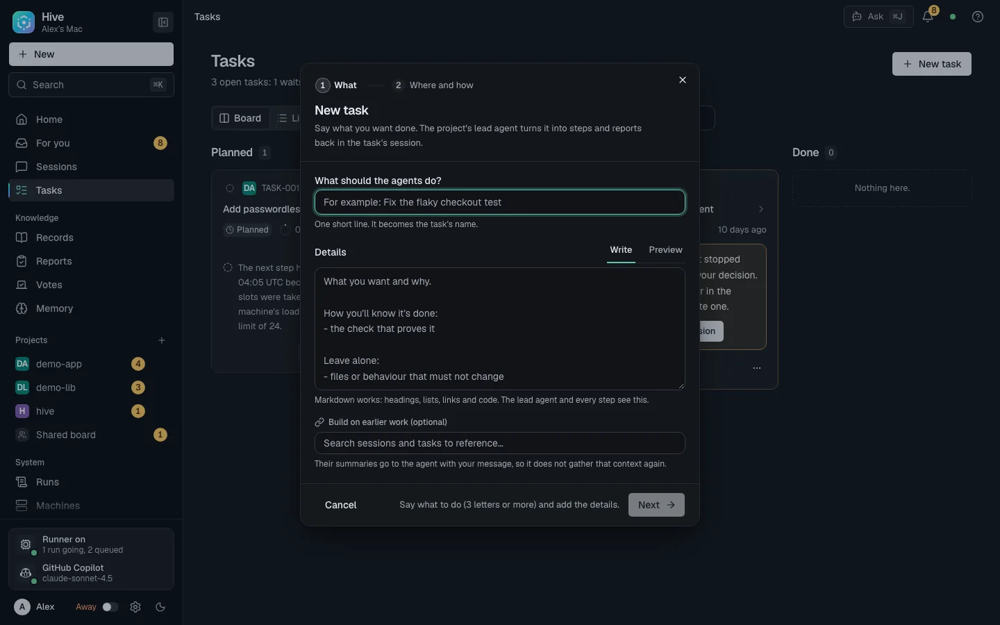

# Give a task and steer it

Write a task an agent can act on, follow the work, answer the lead's
questions, change or cancel the task, and rule on work the agents suggest.

**Before you start**

- A project is registered, a model provider is connected and the runner
  is on ([Set up your first project](first-project.md)).
- The console is open at `http://127.0.0.1:8765`.

## 1. Write the task

A **task** is what you ask for: a title, a brief and a priority.

1. Open **Tasks** in the sidebar and press **New task**.
2. Under **What should the agents do?**, write one short line. It becomes
   the task's name.
3. Under **Details**, write the brief. Markdown works, and **Preview**
   shows it.
4. Press **Next**. Pick the **Project**. Under **How urgent is it?**,
   choose **Low**, **Normal**, **High** or **Urgent**.
5. Press **Create**.



The console says
`Task given. The my-app lead agent is starting on it now and replies in its chat.`
and opens the task. From a terminal, with the brief in a file:

```bash
hive task new --project my-app --title 'Rate-limit the public API' \
  --brief-file brief.md --priority 30
```

It answers `TASK-001 created in my-app: Rate-limit the public API`. The
brief can also be text (`--brief '...'`) or come from stdin
(`< brief.md`). `--priority` is a number, and a higher one is more urgent: the
console's **Low**, **Normal**, **High** and **Urgent** are 0, 10, 30 and
50. The console starts at **Normal**, the command at 0.

### A brief an agent can act on

The lead plans from the brief and writes each job's instructions from it,
so the agents know of your intent only what you wrote. Say what you want
and why. Say how you will know it is done, as a check an agent can run.
Say what to leave alone. For example, `brief.md`:

```markdown
Limit each API key to 600 requests a minute on the public API (`/v1/*`).
One client's runaway script slowed the API for everyone last week.

Done when:
- a key over the limit gets HTTP 429 with a `Retry-After` header;
- `npm test` passes, with a new test that proves the limit.

Leave alone:
- the admin API under `/admin`;
- the format of every existing response.
```

## 2. Know what happens next

Your write wakes the runner: it does not wait for its next planning pass.
The project's **lead** (`my-app-lead`, the agent that owns the project)
reads the task and cuts it into **jobs**, which the console calls steps.
Each job is one agent's run in a throwaway clone of the project, within
the budgets you set ([Choose models and set budgets](models.md)). When
every job is done, their branches become one pull request on the project's
upstream ([Review and merge the work](pull-requests.md)).

| The program says | The console says | What it means |
| --- | --- | --- |
| `open` | **Open** | You gave it. The lead has not planned it yet. |
| `planned` | **Planned** | The lead cut it into jobs. |
| `in_progress` | **In progress** | A job has started. |
| `review` | **Asked you** | The lead stopped and waits for your answer. |
| `done` | **Done** | Its pull request was merged, or you closed it. |
| `cancelled` | **Cancelled** | Cancelled before it was done. |

A task moves down this list, or to `cancelled`. From `review` it goes
back to `in_progress` when you answer. On the **Tasks** page, the
**Board** view has the columns **Planned** (open tasks sit here too),
**In progress**, **Asked you** and **Done**.

The lead is told to give a task's jobs the task's priority, and among jobs
the runner ranks alike otherwise a higher priority runs first. Before
priority comes whose work it is. The owner's work (the lead's runs, answers,
the jobs planned from tasks, pull-request reviews and security updates) goes
ahead of the agents' own. While it waits, the runner keeps one slot on this
machine for it alone, also when the machine is loaded.

While a job from a task is queued in a project, the agents' own jobs that
change code there stay in the queue. When that project already runs as many
jobs as it may, the runner asks the youngest of the agents' runs there to
hold after its current step and carry on later; it asks none of the owner's.
To move waiting work up later, write on the task again: the runner raises
the task's queued jobs to priority 80, once per message.

## 3. Follow the work

Open the task from **Tasks**. It opens on the **Sessions** page as one
conversation: your brief and messages, the lead's replies, and every run
as it happens, with the commands it ran and the files it edited. Under
your latest message, one line says where it stands, from *Sent* to
*Seen by my-app-lead*.

Beside the conversation, **Steps** lists the jobs the lead planned, each
with its state (*Waiting*, *Working*, *Done*, *Failed*). A step that has
run opens that run on the **Runs** page. **Brief** holds what you asked,
the task's details and, once you changed it, its **History**.

From a terminal, `hive task list --project my-app` lists the tasks with
their status. `hive task show TASK-001` prints one task: the brief, its
versions under REVISIONS, the conversation under MESSAGES and the lead's
jobs under JOBS.

## 4. Answer the lead

The lead asks its questions in the task's conversation. When it cannot go
on without your decision, it is told to say why there and stop the task:
the status becomes `review`, **Asked you** in the console. On **Tasks**, the
card moves to the column **Asked you** and gets the button **Open the session**.

The lead's message carries its answers as buttons. Press one, or write
your own answer in the box and press Enter. Either way a stopped task goes
back to **In progress** and the lead takes it from there. An answer can also
close the task (*Good enough, close it*) or open the brief for a change
(*Change what I asked*).

From a terminal, `hive task show TASK-001` prints the question and its
answers, and `hive task reply` sends yours:

```text
MESSAGES
  2026-11-23T04:28:34Z MSG-20261123T042834Z-1 my-app-lead: Count per API key or per IP address?
    [1] Per key, and refuse anonymous calls
    [2] Per key, and per IP for anonymous calls
    [3] Change what I asked  (amend)
```

```bash
hive task reply TASK-001 'Per key, and refuse anonymous calls'
```

The numbered answers are offers, not a menu: `hive task reply` sends
whatever you write, and any reply of yours ends the review. To close the
task instead, run `hive task status TASK-001 done`. Close a task only when
you want nothing more from it: the runner opens no pull request for a
`done` task, so finished work that has none yet is not delivered. The flag
`--choice` is how the lead offers its answers. You do not need it.

## 5. Write to the lead outside a task

Open the project and its **Work** tab. Under **Sessions**, the selector
reads **Whole project**. Write in the box and press Enter. To write about
one task, pick it in the selector.

```bash
hive msg send --project my-app 'Which task do you plan to start next, and why?'
hive msg list --project my-app            # every message; --unread for the new ones
hive msg read MSG-20261123T042834Z-1      # mark one as read
```

A message of yours wakes the runner, and the lead reads it in its next
run. Add `--task TASK-001` to send or list the messages of one task.

## 6. Change or cancel the task

Both moves are on the task's card on **Tasks**, under **More actions**:
**Edit the task** and **Cancel the task**. In the open task, click its
title to edit it, or press **Cancel**.

To change the task, edit the name or the **Details**, say why under
**What changed, and why?**, then press **Save the changes** and
**Yes, save them**. To cancel it, answer **Why are you cancelling it?**
and press **Cancel the task**. From a terminal, with a second task to cancel:

```bash
hive task amend TASK-001 --brief-file brief.md \
  --note 'Halve the limit: 300 a minute, the gateway allows no more.'
hive task cancel TASK-002 --reason 'The changelog moves to the docs site instead.'
```

They answer `TASK-001 amended: rev 2` and `TASK-002 cancelled`. What each
does to the work:

- **A change** is kept as a new version: REVISIONS in `hive task show`,
  **History** on the task's **Brief** tab. A task the lead has not planned
  yet is planned from the new version. A job that has not started gets a
  line in its brief that tells its agent to read the task again. A job
  that is already running keeps the brief it started with, and nothing
  tells it of the change. So when the change matters to work that is
  planned or running, say it in the task's conversation as well.
- **A cancel** is final: to take the work up again, give a new task. Every
  open job of the task ends with it: the queued and the blocked ones are
  cancelled, and a job that is already running has its run asked to stop,
  as **Cancel run** on its **Steps** would; it ends `cancelled by the
  owner` within a few seconds. The `task.cancelled` event counts them
  (`cancelled_jobs`, `blocked_jobs`, `leased_jobs`, `stopped_runs`).

Hive refuses to amend a task that is `done` or `cancelled`, and the runner
opens no new pull request for it. A closed task has no running jobs: a
queued job of it is never leased (the lease cancels it with the reason),
and `hive job finish JOB queued` or `hive job retry` refuses to put one of
its blocked or failed jobs back in the queue. Work still wanted after a
task is done - a review's follow-up, a fix found later - is a new task:
`hive job add --source task:<id>` refuses a done or cancelled task, and a
source that names no task of the project (`task:126:followups`), and says
`hive task new` instead ([Landing](../landing.md#work-for-a-closed-task)
says why).

## 7. Rule on suggested work

Agents propose work too. A **suggestion** is written like a task, and a
different agent reviews it before it becomes one. The reviewer accepts it
(it is a task from then on), declines it, or hands it to you.

- Those handed to you wait on **For you** under **Suggested work**, each
  with **Accept** and **Decline**. **Accept** opens **Make it a task?**,
  where you can sharpen the name and set the urgency.
  **Accept, make it a task** creates the task.
- The open suggestions of a project are on its **Work** tab under
  **Suggested next**, each with where its review stands. **Suggest work**
  adds one of your own, and an agent reviews it the same way.

```bash
hive task suggestions --project my-app --status owner   # the ones handed to you
hive task show SUG-002                                  # the why, and the reviewer's reason
hive task review SUG-002 decline --reason 'Two partners still call /v0.'
hive task review SUG-001 accept --reason 'the build broke on it twice'
```

The last one answers `SUG-001 accepted: TASK-003 created in my-app`. You
may rule on any open suggestion without waiting for its reviewer.

## Check that it worked

- On **Tasks**, the task sits in the column of its status, and its
  conversation holds the lead's reply.
- `hive task list --project my-app` shows the task with its status, and
  `hive task show TASK-001` the lead's reply and the jobs it planned.

## When something goes wrong

- **Your message says *Sent · nobody has picked it up yet*.** Two minutes
  passed and no run of the lead took it. Most often the runner is off or
  paused, or no model provider is connected. Home says which
  ([Set up your first project](first-project.md),
  [Troubleshooting](troubleshooting.md)).
- **A command prints `A project is needed`.** `hive task new` needs
  `--project`, and so does `hive msg send` without `--task`.
  `hive projects` lists the names.
- **The lead writes `I stopped TASK-001`.** After three failed jobs, or
  fewer when the lead finds nothing else to try, the runner stops the task
  for you, with the answers *Try again another way*, *Good enough, close it*
  and *Change what I asked*. Pick one, or write what you want instead.
- **A suggestion gets no verdict.** Its review is the agents' own work.
  Once `jobs_per_day` jobs (2, yours included) have run in a UTC day, the
  runner starts only your own work until midnight UTC. Raise the number
  under **Settings**, **Limits**, **Runs per day (all machines together)**.

## Read more

- [Tasks in the console](../console.md#tasks): the conversation and the
  delivery line in full.
- [Suggested work](../board.md#suggested-work-hive-task-suggest): the
  review job and the verdicts.
- [The express lane for the owner's work](../landing.md#the-express-lane-for-the-owners-work):
  how your work gets a slot.
- [Answer what waits for you](what-needs-you.md): the rest of your round.
